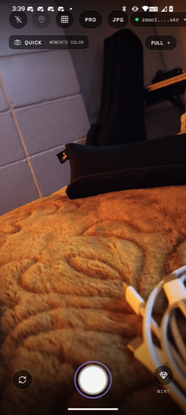
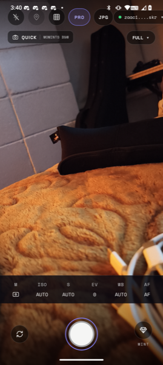
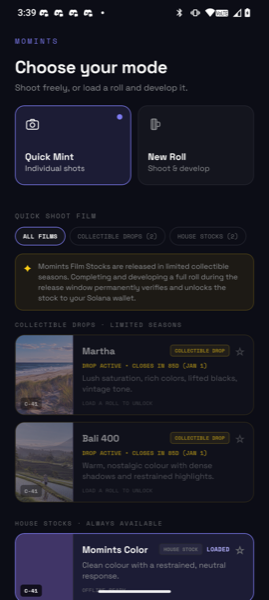
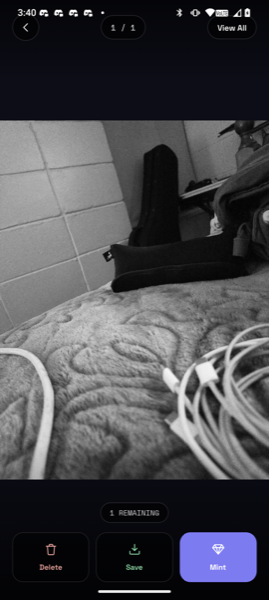
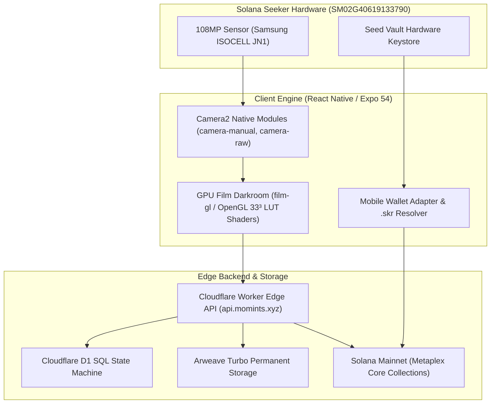

# Momints

<p align="center">
  
</p>

<p align="center">
  <strong>Shoot. Mint. Yours.</strong><br>
  <em>The analog film camera dApp engineered from the metal up for Solana Seeker.</em>
</p>

<p align="center">
  <a href="https://drive.google.com/open?id=1VjTt1PufCO_M8B7y506mZWi9zdloVcKI">
    
  </a>
  
  
  
</p>

---

## ⚡ 60-Second Evaluator Quick Start

Judges and evaluators can install and launch the verified submission APK directly without compiling from source:

### 1. Download & Install

| Target Environment                                | Recommended Artifact                                                                            | One-Line ADB Install Command             |
| :------------------------------------------------ | :---------------------------------------------------------------------------------------------- | :--------------------------------------- |
| **Physical Solana Seeker** _(Tested hardware)_    | [`momints-v2.0-seeker.apk`](https://drive.google.com/open?id=1VjTt1PufCO_M8B7y506mZWi9zdloVcKI) | `adb install -r momints-v2.0-seeker.apk` |
| **Android Studio Emulator** _(arm64 / API 34–36)_ | [`momints-v2.0-seeker.apk`](https://drive.google.com/open?id=1VjTt1PufCO_M8B7y506mZWi9zdloVcKI) | `adb install -r momints-v2.0-seeker.apk` |

```bash
# In-place installation (preserves existing wallet credentials and encrypted roll state)
adb install -r momints-v2.0-seeker.apk

# Launch the application
adb shell am start -n com.momints.v2qa/.MainActivity
```

> **Android Security Verification:**  
> When installing standalone APKs outside the Google Play Store, Android Play Protect may show a prompt. Click **More details** ➔ **Install anyway**.

---

## 📸 Visual Showcase

<p align="center">
  
  
  
  
</p>

<p align="center">
  <em>(1) Live Seeker Viewfinder with decoupled AF/AE rings & .skr badge · (2) Pro Manual Strip & LomoKino cadence selector · (3) Curated Film Stock Shelf · (4) GPU darkroom review & Arweave permanent proof</em>
</p>

---

## 🎯 What Momints Does & How to Use It

Momints brings the deliberate craft, tactile friction, and permanent digital provenance of 35mm analog film photography natively to Web3.

### Core User Workflow

1. **Connect Wallet & Identity:**  
   Tap the wallet chip in the viewfinder header. One-tap Mobile Wallet Adapter (MWA) authentication binds securely to Seed Vault. The camera HUD instantly reverse-resolves your address to your verified `.skr` handle (e.g., `trav.skr` or `zaac.skr`).
2. **Choose Your Shooting Mode:**
   - **Quick Mint Mode:** Spontaneous point-and-shoot. Captures develop on-device instantly and mint to Solana Mainnet in one biometric confirmation.
   - **Prepaid Film Roll Mode (12 or 24 Frames):** The authentic analog experience. Purchase a roll on-chain. Frames are held inside an on-device AES-encrypted sandbox—**photos cannot be previewed or dopamine-scrolled until the entire roll is finished**, restoring the authentic anticipation of film development.
3. **Dial In Exposure & Crank the Shutter:**
   - **Pro Manual Controls:** Tap `PRO` to expand tactile dials for ISO (50–3200), calibrated Shutter Speeds (1/8000s to 1/2s + bulb), manual AF diopter focus, and edge-aware EV compensation.
   - **LomoKino Motor Drive:** Toggle the `KINO` chip to 3, 5, or 8 FPS. Hold the shutter button to crank continuous motor-drive bursts, complete with mechanical haptics and rotary shutter blade blackout playback.
   - **Multiple Exposure (MX):** Capture frame one to project a live ghost overlay in your viewfinder, then fire frame two to blend an additive double exposure.
4. **Develop & Mint to Permanence:**  
   On roll completion, the on-device GPU shader darkroom applies authentic 33³ 3D LUTs, optical halation bloom, and procedural silver grain in under 60ms. The roll is batch-minted as an immutable Metaplex Core Collection on Solana Mainnet, with full-resolution negatives permanently archived on Arweave via Turbo.

---

## 💡 Why This App Was Made (The Core Ethos)

> _"Your camera shouldn't just capture data. It should create artifacts that outlast the device in your hand."_

- **The Death of Intentionality in Digital Photography:**  
  Smartphones made photography friction-free, but in doing so, destroyed intentionality, craft, and emotional consequence. When taking a picture costs nothing and storage is infinite, no single photograph holds value. Momints re-introduces physical consequence: buying a roll and advancing frames makes every shutter press a conscious artistic choice.
- **The Cloud Rent-Seeking Trap vs. Sovereign Ownership:**  
  Users do not own their camera rolls. Centralized cloud platforms rent access to memories back through monthly subscriptions, compress high-res originals, and scrape personal photos for advertising algorithms. Momints replaces rented cloud storage with sovereign, permanent ownership on Arweave backed by on-chain Metaplex Core provenance.
- **The Web3 Mobile Void:**  
  Most mobile crypto dApps are clunky desktop websites wrapped in an iframe. Momints treats the smartphone’s primary sensory instrument—the physical camera lens—as a first-class decentralized tool, speaking directly to Seeker's Camera2 HAL and Seed Vault hardware keystore.

---

## ⚙️ The Upstream Engine Room (Architecture & Verification)



### Reproducible Quality Gate (<2s)

The repository includes comprehensive automated test coverage enforcing wallet security, cryptographic signature slicing, roll state recovery, and memory privacy:

```bash
# Install locked dependencies
npm ci

# Run strict TypeScript compilation (0 errors)
npx tsc --noEmit

# Run fast unit test suites (109 passing in <2s)
node --test tests/privacy.test.cjs tests/roll-authorization.test.cjs \
  tests/wallet-auth-cache.test.cjs tests/on-chain-portfolio.test.cjs \
  tests/assetlinks.test.cjs tests/kino-settings.test.cjs \
  tests/focus-lock-and-pro.test.cjs tests/camera-raw.test.cjs \
  tests/roll-payment-recovery.test.cjs tests/roll-server-recovery.test.cjs \
  tests/recovery-operations.test.cjs tests/recovery-db.test.cjs \
  tests/roll-session-recovery.test.cjs tests/burst-roll-numbering.test.cjs \
  tests/roll-frame-number-repair.test.cjs
```

### Reproducible APK Build from Source

```bash
# Compile standalone release APK using hackathon signing identity
node scripts/build-submission-apk.cjs \
  --hackathon-debug-signing \
  --expected-cert-sha256 fac61745dc0903786fb9ede62a962b399f7348f0bb6f899b8332667591033b9c \
  --credentials credentials.json
```

---

## 👥 Authors & Provenance

- **Zaac** ([@ZaacIsHere](https://github.com/ZaacIsHere)) — Native Client Architecture, Camera2 HAL, Seeker DVT Hardware Verification, UI/UX.
- **Travis** ([@trav-1111](https://github.com/trav-1111)) — Cloudflare Worker Architecture, D1 Ledger, Metaplex Core Smart Contracts, Arweave Turbo Pipeline.

_Repository maintained for the **CLOCK IN: Solana Mobile Hackathon 2026**._
