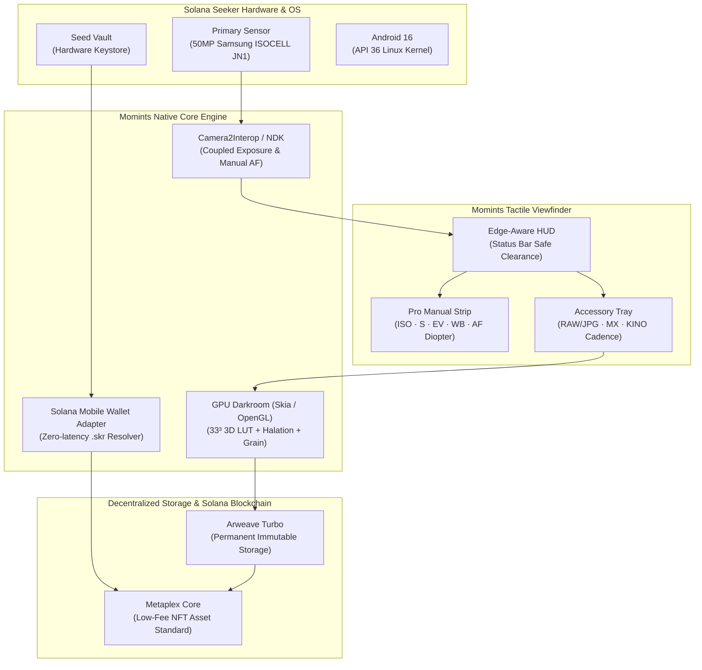

# Momints V2 — Comprehensive Feature Specification & Hackathon Demo Guide

> **CLOCK IN: The Solana Mobile Hackathon 2026**  
> **Platform:** Solana Seeker Native Android Application  
> **Repository:** `trav-1111/momints` & `izaacsalway/momints`  
> **Release Candidate:** Momints V2.0 (`momints-v2.0-seeker.apk`)  
> **Target Device:** Solana Seeker (DVT / Android 16 / API 36)

---

## 1. Executive Summary & Product Vision

### The Problem
Smartphones have made photography virtually frictionless, but in doing so, destroyed **intentionality**, **craft**, and **ownership**:
- Billions of disposable photos sit unviewed in centralized cloud silos (Google Photos, Apple iCloud).
- Users rent access to their memories under recurring subscription lock-ins.
- Flat computational photography algorithms over-sharpen and standardize imagery, robbing digital photos of character and soul.

### The Momints Solution
**Momints brings the craft, tangible mechanics, and permanent digital provenance of 35mm analog film photography natively to Web3 on Solana Seeker.**
- **Shoot:** Authentic film rolls, tactile manual dials, calibrated shutter speeds, optical ISO sensitivity, and mechanical burst drives.
- **Develop:** On-device GPU shader darkroom running 33³ 3D color lookup tables (LUTs), organic halation bloom, and procedural silver halide grain.
- **Own:** Permanent, uncensorable storage on Arweave via Turbo, minted directly into your wallet as next-generation Metaplex Core digital assets via the Solana Mobile Wallet Adapter (MWA) and Seed Vault.

---

## 2. System Architecture & Seeker-Native Integration



### Key Architectural Pillars
1. **Camera2Interop Engine:** Bypasses generic high-level camera wrappers to speak directly to Seeker's Camera2 HAL. Supports full manual ISO, exposure time, manual focus diopters, auto-exposure lock, and DNG raw capture.
2. **On-Device GPU Film Darkroom:** Real-time Skia and OpenGL shading pipeline applies 33³ tetrahedral interpolated 3D LUTs, realistic optical red halation around high-luminance edges, authentic procedural silver grain, and vintage corner vignetting in under 60ms.
3. **Seed Vault & MWA Integration:** Zero private key exposure. Biometric fingerprint authorization signs roll minting transactions in milliseconds.
4. **Zero-Latency Reverse Domain Resolver:** Instantly resolves connected wallet public keys to human-readable `.skr` and SNS domain identities (e.g., `trav.skr`), dynamically reflected on the camera HUD.

---

## 3. Complete Feature Guide

### 3.1 Dual Shooting Modes

#### A. Quick Mint Mode
- **Purpose:** Spontaneous, single-shot film capture with immediate minting.
- **Workflow:**
  1. Frame your subject using custom aspect ratios (`FULL`, `1:1`, `4:3`, `16:9`).
  2. Tap the shutter button; on-device darkroom develops the frame instantly with the active film stock.
  3. Single-tap `MINT` opens the Solana Mobile Wallet Adapter, uploads the image and verified EXIF metadata to Arweave Turbo, and mints an immutable Metaplex Core asset to your wallet.

#### B. Prepaid Roll Mode (Authentic Film Experience)
- **Purpose:** Commitment, discipline, and intentionality.
- **Workflow:**
  1. Load a 12, 24, or 36 exposure roll of your chosen film stock.
  2. Frames are captured and locked into an on-device encrypted sandbox.
  3. The vintage **EXP Counter** dial counts down frames remaining.
  4. Once the final frame is exposed, the shutter locks: *"Roll Complete — Ready to Develop"*.
  5. One-tap development triggers batch processing and mints a single **Metaplex Core Collection** containing all individual frames plus an automatically generated high-resolution **Contact Sheet**.

---

### 3.2 Pro Manual Controls (The Tier 2 Photography Engine)

Accessible via the `PRO` toggle on the top HUD. Tapping expands a precision camera strip:

| Control | Parameter Range | Photographic Mechanism |
| :--- | :--- | :--- |
| **M / AUTO** | Auto vs Full Manual | Switches between Seeker Auto-Exposure and fully coupled manual control. |
| **ISO** | ISO 50 to ISO 3200 | Sets sensor analog gain in standard optical stops (50, 100, 200, 400, 800, 1600, 3200). |
| **Shutter Speed (S)** | 1/8000s to 1/2s + Bulb | Controls exposure sensor integration time. Speeds longer than 1/15s trigger a tactile *"Hold Still"* long exposure guide. |
| **EV Compensation** | -3.0 EV to +3.0 EV | Edge-aware exposure compensation slider with 1/3 stop increments. |
| **White Balance (WB)** | Auto / 3200K / 4000K / 5500K / 6500K / 7500K | Presets calibrated for Tungsten, Fluorescent, Daylight, Cloudy, and Open Shade. |
| **Manual Focus (AF)** | 0.0 D (∞) to 10.0 D (10cm Macro) | Precision diopter rotary dial with haptic detents for fine-grained focal plane control. |
| **Metering** | Matrix / Center / Spot | Selectable AE calculation weights across the frame sensor. |
| **Composition Grid** | Off / 3x3 Thirds / Golden Ratio / Square | Golden spiral and rule-of-thirds overlays for framing. |

---

### 3.3 Pro Accessory Tools (Below Manual Controls)

Located directly beneath the manual controls strip in an ergonomic 34dp chip tray:

#### 1. RAW / JPG Capture Toggle
- **Action:** 1-tap toggle between standard processed JPG and dual DNG RAW + JPG capture.
- **Mechanism:** Leverages Seeker's RAW_SENSOR output. Preserves an uncompressed raw digital negative alongside the developed film stock.

#### 2. Multiple Exposure (MX)
- **Action:** 1-tap `MX` toggle.
- **Workflow:**
  1. Take the first exposure: The frame is captured and rendered as a semi-transparent ghost overlay on the active viewfinder.
  2. Frame your second exposure using the ghost overlay for perfect composition.
  3. Fire the shutter: An additive luminance blending shader fuses both exposures into a single composite negative.

#### 3. Lomokino motor drive (Burst mode)
- **Action:** Toggle the burst button to cycle cadence:
  - **State 0 (Off):** Single-shot mode (burst off).
  - **State 1 (3 FPS):** Displays `🎞️ 3 FPS` (active gold). Slow vintage hand-crank cadence.
  - **State 2 (5 FPS):** Displays `🎞️ 5 FPS` (active gold). Classic 35mm movie camera cadence.
  - **State 3 (8 FPS):** Displays `🎞️ 8 FPS` (active gold). High-speed motor drive cadence.
  - **State 4 (Cycle Off):** Returns to single-shot mode.
- **Cranking Feedback:** Holding the shutter triggers continuous bursts with haptic gear-tooth vibrations and a rotating mechanical dashed animation around the shutter ring.
- **Sequential Stills Capture:** Burst frames are saved as discrete, full-resolution still exposures that advance across your film roll, ready for contact sheet review and darkroom development.

---

### 3.4 Curated Film Stock Showcase & Visual Thumbnails

Momints launches with **6 curated film stocks** covering iconic photographic aesthetics:

| Film Stock | Category | Aesthetic Characteristics |
| :--- | :--- | :--- |
| **Momints Color** | House (Evergreen) | Vibrant, natural skin tones, balanced contrast, all-around C-41 color negative. |
| **Momints B&W** | House (Evergreen) | High dynamic range monochrome, deep rich shadows, classic silver halide character. |
| **Aura 400** | Quick Mint Demo | Warm golden hour warmth, soft highlight halation, flattering portrait palette. |
| **Amber 200** | Quick Mint Demo | Vintage 1970s warmth, amber undertones, nostalgic saturation. |
| **Silver 400** | Quick Mint Demo | Fine-grain street photography black & white with crisp edge acutance and punchy midtones. |
| **Neon 800T** | Quick Mint Demo | Cinematic tungsten-balanced stock with distinctive red halation bloom around direct lights. |

#### Live Visual Film Picker
- The camera HUD film chip features a **live miniature thumbnail preview** of the active stock.
- Tapping the chip expands a 1-tap quick selection tray showing visual previews and tags (`HOUSE` vs `DEMO`), allowing instant switching without leaving the camera screen.

---

## 4. Step-by-Step Demo Video Guide (For Travis's Shoot)

### Preparation Checklist
1. **Device:** Physical Solana Seeker phone, cleaned screen, connected to Wi-Fi.
2. **App:** Launch Momints V2 (`momints-v2.0-seeker.apk`).
3. **Wallet:** Seed Vault wallet connected with `.skr` domain (shows green pill e.g. `trav.skr`).
4. **Environment:** Well-lit tabletop with a warm desk lamp and a couple of physical props (an analog camera, vintage lens, or printed contact sheet).

---

### Scene-by-Scene Director's Script (3:00 Target)

```
[ 0:00 - 0:25 ] SCENE 1: THE HOOK
Visual: 
- Close-up shot holding Seeker in portrait mode.
- Tap Momints app icon. App opens instantly; mechanical shutter click sound plays.
Voiceover Cue:
"Every day, billions of photos are taken on mobile phones. But infinite digital storage made photography disposable. We capture thousands of photos we never look at, locked in corporate cloud silos.
This is Momints. We’re bringing the craft, intentionality, and permanence of analog film photography to Web3—built natively from the metal up for Solana Seeker."
```

```
[ 0:25 - 1:05 ] SCENE 2: SEEKER-NATIVE CAMERA & PRO CONTROLS
Visual:
- Point out top right HUD: 'trav.skr' glowing green.
- Tap screen: separate Focus and Exposure rings, drag EV sun slider up/down.
- Tap 'PRO' button: manual strip slides down smoothly.
- Spin Shutter Speed dial (snap through 1/250s, 1/500s, 1/1000s) feeling haptic ticks.
- Adjust Focus Diopter dial: watch macro subject pop into crisp focus.
Voiceover Cue:
"Momints isn't a wrapped webview. It's written in native Android C++ and Kotlin optimized for Seeker's silicon.
Notice the HUD recognizes our wallet as trav.skr through our zero-latency reverse resolver.
We have decoupled focus and exposure lock rings, edge-aware EV compensation, and a calibrated physical shutter dial that snaps through genuine optical stops with tactile haptic response."
```

```
[ 1:05 - 1:45 ] SCENE 3: LOMOKINO BURST MODE & DOUBLE EXPOSURE
Visual:
- In the Pro accessory row, toggle the burst button: button turns gold displaying '🎞️ 3 FPS', tap to '5 FPS', tap to '8 FPS'.
- Hold down the shutter button: dashed crank gear spins, haptic vibrations buzz, counter counts up (1.. 2.. 3.. 4.. 5.. 6..).
- Release. Show quick review of captured sequential still frames on the contact sheet.
- Show 'MX' button: tap MX, take shot of desk lamp, show ghost overlay on screen, frame second shot, snap double exposure!
Voiceover Cue:
"In Momints, creative tools are tactile. With Lomokino motor drive (Burst mode), tap to cycle 3, 5, or 8 frames per second. Hold the shutter to crank a high-speed motor burst of sequential stills, capturing action frame-by-frame directly to your roll.
And with our multiple-exposure engine, frame one creates a live ghost overlay in your viewfinder, blending seamlessly into an additive double exposure."
```

```
[ 1:45 - 2:25 ] SCENE 4: THE DARKROOM & ON-CHAIN MINTING
Visual:
- Load a film roll or shoot in Quick Mint.
- Tap 'MINT' or 'Develop Roll'.
- Solana Mobile Wallet Adapter modal appears via Seed Vault. Tap approve with fingerprint biometric.
- Progress animation: Skia/OpenGL GPU darkroom applies 33³ 3D LUT, halation, and procedural silver grain.
- Developed contact sheet / asset displays on screen in full high-resolution beauty!
Voiceover Cue:
"When your shot is taken, our on-device GPU shader darkroom applies authentic 33-point 3D LUTs, optical halation, and procedural silver halide grain in under 60 milliseconds.
With one biometric tap through Seed Vault and Mobile Wallet Adapter, your photo is uploaded permanently to Arweave via Turbo and minted directly into your wallet as an immutable Metaplex Core asset. No intermediate tokens, no custodial lag. Yours forever."
```

```
[ 2:25 - 2:45 ] SCENE 5: FILM SHELF & ON-CHAIN UNLOCKS
Visual:
- Open Film Shelf / Mode Select.
- Show 6 curated stocks with live visual thumbnails: Momints Color, Momints B&W, Aura 400, Amber 200, Silver 400, Neon 800T.
- Show how creator drops and collectible stocks are verified on Solana.
Voiceover Cue:
"Every roll is an on-chain digital artifact. And through Solana's Digital Asset Standard, developing rolls unlocks exclusive collectible film stocks and community drops—completely decentralized."
```

```
[ 2:45 - 3:00 ] SCENE 6: OUTRO & CALL TO ACTION
Visual:
- Pull back shot showing Seeker phone next to physical analog camera and printed contact sheet.
- End screen graphic with Momints logo, GitHub link, and:
  'CLOCK IN. Solana Mobile Hackathon 2026.'
Voiceover Cue:
"Photography made permanent. Built for Solana Seeker.
This is Momints. Shoot. Mint. Yours."
```

---

## 5. V3 Creative Roadmap & Collectible Drops (Future Horizon)

For hackathon judges assessing technical depth and project longevity, Momints has already architected two major extensions:

### 1. V3 Creative Features (`docs/V3_CREATIVE_ROADMAP_SPEC.md`)
- **Emulated Aperture & Computational DoF:** Synthetic bokeh circle of confusion (CoC) rendering simulating f/1.4 to f/16 diaphragm blades, coupled with Seeker's Camera2 focus distance.
- **Darkroom Creative Developing Techniques:**
  - *Push/Pull Processing:* Simulate developer bath adjustments (+1/+2 EV push = rich microcontrast and dense grain; -1 EV pull = muted shadow gradation).
  - *Cross-Processing (X-Pro):* E-6 slide film in C-41 chemistry producing vivid surreal color shifts.
  - *Bleach Bypass:* Retaining silver halide for desaturated, high-contrast cinematic imagery.
  - *Solarization (Sabattier Effect):* Partial tone curve reversal in highlight regions.

### 2. Collectible Film Stock Drops (`docs/COLLECTIBLE_FILMSTOCKS_CATALOGUE.md`)
- Complete catalogue of 12 iconic film stocks specified with exact `FilmStockRecipeV2` parameters (33³ LUT, grain roughness, halation radius, bloom, vignette) ready for time-limited collectible on-chain drops.
