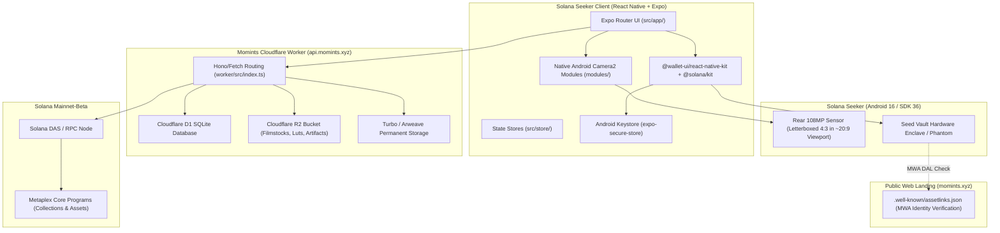

# Momints System Architecture Map & Component Topology

> **Audience:** Autonomous AI coding agents (Claude, Codex, Antigravity, Cursor) and human maintainers.  
> **Purpose:** Structural map of the codebase, contracts, boundaries, and hardware integrations.

---

## 1. High-Level System Topology

---

## 2. Component Boundaries & Codebase Directory Map

### 2.1 Mobile Application Frontend (`src/`)

| Directory / File | Role & Technology | Key Invariants |
| :--- | :--- | :--- |
| `src/app/` | Expo Router screen routes (`camera.tsx`, `mode-select.tsx`, `review.tsx`, `past-mints.tsx`, `contact-sheet.tsx`). | Navigation, mode toggling, viewfinder presentation. |
| `src/app/_layout.tsx` | Root provider hierarchy. Injects `walletAuthCache` into `<MobileWalletProvider>` and sets MWA identity (`name: 'Momints'`, `uri: 'https://momints.xyz'`). | MWA provider root; drains unfinalized mints on app foreground. |
| `src/components/` | UI components: manual controls, viewfinder framing, aspect overlays, film stock picker, wallet status pill. | Coordinate transforms must account for letterboxing. |
| `src/store/` | Zustand reactive state: `photos.ts`, `filmstocks.ts`, `session.ts`, `mintQueue.ts`, `rollRegistry.ts`, `locationSettings.ts`. | Local session state; offline sync for film recipes. |
| `src/services/` | Business logic services (see Section 2.2). | Cryptography, transaction preparation, API clients. |

---

### 2.2 Core Services & Cryptographic Handshakes (`src/services/`)

| Service File | Functionality | Critical Details |
| :--- | :--- | :--- |
| [`walletAuthCache.ts`](file:///Users/zaac/momints/src/services/walletAuthCache.ts) | Encrypted MWA authorization token cache. Uses `expo-secure-store` backed by Android Keystore. | **Atomic migration:** writes to `SecureStore` FIRST, only deletes legacy `AsyncStorage` on successful write. |
| [`rollApi.ts`](file:///Users/zaac/momints/src/services/rollApi.ts) | Client for `api.momints.xyz`. Handles roll creation, frame uploads, completion, and legacy recovery. | Slices 64-byte Ed25519 signatures; stages recovery tokens prior to dispatch. |
| [`rollCapability.ts`](file:///Users/zaac/momints/src/services/rollCapability.ts) | Manages 256-bit base64url bearer capability tokens in `SecureStore`. | Staging keys: `pending-roll-capability-${wallet}`, `recovery-roll-capability-${collection}`. |
| [`quickMintApi.ts`](file:///Users/zaac/momints/src/services/quickMintApi.ts) | Stages quick mint images on Worker, obtains quote/terms, coordinates client signing and finalization. | Fee terms come strictly from Worker; client never hardcodes lamports. |
| [`mint.ts`](file:///Users/zaac/momints/src/services/mint.ts) | Builds Metaplex Core transactions with Umi & `@solana/kit`. | Signs via MWA; dispatches and confirms on Solana RPC. |
| [`filmProcessor.ts`](file:///Users/zaac/momints/src/services/filmProcessor.ts) | Processes captured frames using active film stock recipes and 3D LUTs. | Verified native receipts; fails closed on corrupt/missing LUT. |
| [`privacyPathGuard.cjs`](file:///Users/zaac/momints/src/services/privacyPathGuard.cjs) | Sandboxing guard for all local photo files. | Prevents path traversal; ensures private files only write to app-owned cache. |

---

### 2.3 Native Android Modules (`modules/`)

| Module | Language | Purpose & Seeker HAL Reality |
| :--- | :--- | :--- |
| `modules/camera-manual/` | Kotlin / Android Camera2 | Direct Camera2 sensor binding. Locks exposure via `CONTROL_AE_MODE_OFF`. Implements manual ISO, shutter speed (nanoseconds), focus distance, and white balance. |
| `modules/camera-raw/` | Kotlin / Android Camera2 | Direct `RAW_SENSOR` buffer capture and Adobe `DngCreator` compilation. Saves 16-bit lossless Bayer negative before film simulation. |
| `modules/camera-caps/` | Kotlin | Hardware capabilities probe. Reads supported sensor formats, zoom ratios, flash capabilities, and exposure ranges from `CameraCharacteristics`. |
| `modules/film-gl/` | C++ / OpenGL ES | High-performance GPU color grading and 3D LUT texture application. |

---

### 2.4 Cloudflare Worker Backend (`worker/`)

* **Endpoint Host:** `https://api.momints.xyz` (promoted staging service `momints-roll-worker-staging`).
* **Routing:** `worker/src/index.ts`.
* **Database (D1):** SQLite schema tracking rolls, frame counters, auth hashes, fee signatures.
* **Storage (R2 & Turbo):** R2 caches immutable film stock recipes and temporary staging images. Turbo / Arweave handles permanent image and JSON metadata persistence.
* **Key Routes:**
  * `POST /rolls`: Create a prepaid roll (gated strictly by on-chain fee verification).
  * `GET /rolls/open?wallet=<addr>`: Returns wallet's single open roll.
  * `POST /rolls/<collection>/frames`: Mint a frame with `Authorization: Roll <bearerToken>`.
  * `POST /rolls/<collection>/authorize`: Wallet-signed recovery for legacy rolls.
  * `POST /quick/stage` & `POST /quick/finalize`: Quick-mint staging and fee verification.
  * `GET /.well-known/assetlinks.json`: Direct assetlinks endpoint (fallback).

---

### 2.5 External Identity & Solana Mobile Wallet Adapter Verification

* **Declared App Identity:** `name: 'Momints'`, `uri: 'https://momints.xyz'` (in `src/app/_layout.tsx`).
* **MWA Verification Rule:** When a wallet (Seed Vault, Phantom) connects, it fetches `https://<declared-identity-host>/.well-known/assetlinks.json`.
* **Host Requirement:** Because the app declares `https://momints.xyz`, the Digital Asset Links file must be hosted by the web server serving the `momints.xyz` root domain.
