# Momints Film Stock & LUT Showcase Catalogue

> **Internal Review Document for Zaac & Trav.**  
> Visual proof sheet and technical index of all curated film stocks available for selection and staging in Momints.  
> All protected brand trademarks have been safely abstracted into evocative Momints names.

---

## 1. Quick Comparison Index

| Stock Name | Category | Inspiration | Key Aesthetic |
| :--- | :--- | :--- | :--- |
| **Momints Aura 400** | Color Negative | *Kodak Portra 400 (C-41)* | Warm natural skin tones, soft pastel highlights, restrained contrast, iconic portrait look. |
| **Momints Neon 800T** | Cine & Specialty | *CineStill 800T / Vision3 500T* | Tungsten balanced cinema emulsion. Deep teal night shadows and warm highlight glow. |
| **Momints Vivid 50** | Color Reversal / Slide | *Fuji Velvia 50 (E-6)* | Ultra-punchy saturation, deep blacks, high contrast. The quintessential landscape slide film. |
| **Momints Amber 200** | Color Negative | *Kodak Gold 200 (C-41)* | Nostalgic golden-hour glow with warm amber highlights and classic vacation snapshots feel. |
| **Momints Silver 400** | Black & White | *Kodak Tri-X 400 (B&W)* | Classic photojournalistic silver halide. Gritty high-contrast punch with rich velvety blacks. |
| **Bali 400** | Color Negative | *Tropical Warm Negative* | Warm nostalgic color with dense shadows, restrained highlights, and muted tropical greens. |
| **Martha** | Vintage Reversal | *Vintage Saturation Reversal* | Lush saturation, rich jewel colors, lifted matte blacks, and classic nostalgic tone. |
| **Momints Chrome 64** | Color Reversal / Slide | *Kodachrome 64 (K-14)* | Legendary National Geographic archival look: warm amber-yellow bias and punchy primary colors. |
| **Momints Ektar 100** | Color Negative | *Kodak Ektar 100 (C-41)* | Ultra-fine grain with the highest saturation of any color negative film. Crisp cyan and red pop. |
| **Momints Provia 100F** | Color Reversal / Slide | *Fuji Provia 100F (E-6)* | Faithful, neutral slide film. Uncompromising daylight color accuracy and clean emerald greens. |
| **Momints HP5 Plus** | Black & White | *Ilford HP5 Plus (B&W)* | Smooth wide tonal latitude with gentle highlight roll-off and balanced medium contrast. |
| **Momints Lomo Purple** | Creative Specialty | *LomoChrome Purple XR* | Surreal experimental infrared shift: foliage greens transform into electric violet and magenta. |

---

## 2. Visual Proof Sheet (Side-by-Side Review)

### Benchmark Scene: Original Reference

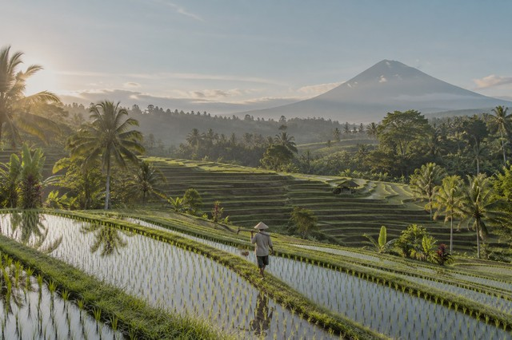

---

### Category: Color Negative

#### Momints Aura 400 (`momints-aura-400`)
- **Inspiration:** *Kodak Portra 400 (C-41)*
- **Look & Mood:** Warm natural skin tones, soft pastel highlights, restrained contrast, iconic portrait look.
- **Visual Traits:** `warm skin tones` · `pastel highlights` · `soft contrast` · `portrait`

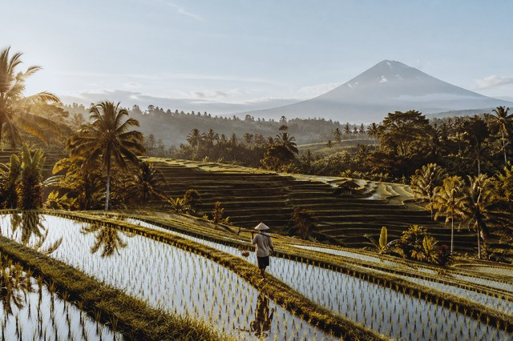

---

#### Momints Amber 200 (`momints-amber-200`)
- **Inspiration:** *Kodak Gold 200 (C-41)*
- **Look & Mood:** Nostalgic golden-hour glow with warm amber highlights and classic vacation snapshots feel.
- **Visual Traits:** `golden amber` · `nostalgic warmth` · `everyday film` · `vintage snap`

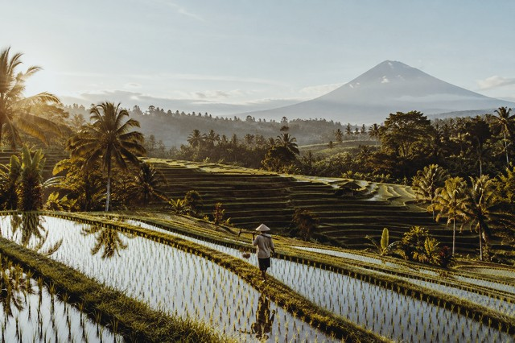

---

#### Bali 400 (`bali-400-v1`)
- **Inspiration:** *Tropical Warm Negative*
- **Look & Mood:** Warm nostalgic color with dense shadows, restrained highlights, and muted tropical greens.
- **Visual Traits:** `warm skin tones` · `restrained highlights` · `muted greens` · `subtle grain`

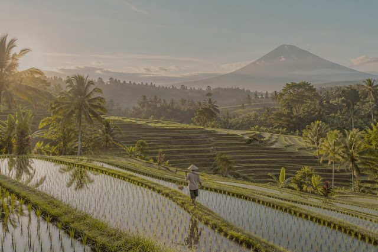

---

#### Momints Ektar 100 (`momints-ektar-100`)
- **Inspiration:** *Kodak Ektar 100 (C-41)*
- **Look & Mood:** Ultra-fine grain with the highest saturation of any color negative film. Crisp cyan and red pop.
- **Visual Traits:** `ultra-fine grain` · `saturated negative` · `vibrant cyan/red` · `crisp acutance`

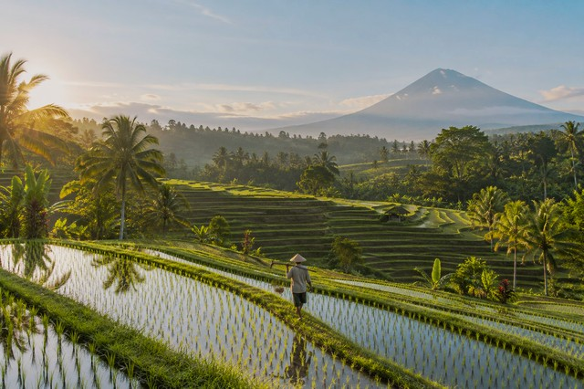

---

### Category: Color Reversal / Slide

#### Momints Vivid 50 (`momints-vivid-50`)
- **Inspiration:** *Fuji Velvia 50 (E-6)*
- **Look & Mood:** Ultra-punchy saturation, deep blacks, high contrast. The quintessential landscape slide film.
- **Visual Traits:** `high saturation` · `deep blacks` · `emerald greens` · `vivid landscape`

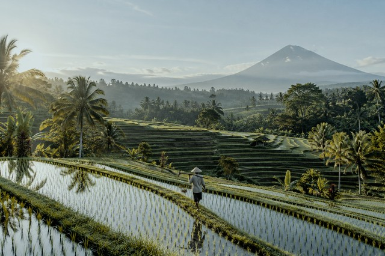

---

#### Momints Chrome 64 (`momints-chrome-64`)
- **Inspiration:** *Kodachrome 64 (K-14)*
- **Look & Mood:** Legendary National Geographic archival look: warm amber-yellow bias and punchy primary colors.
- **Visual Traits:** `warm yellow-red` · `punchy primaries` · `archival look` · `national geographic`

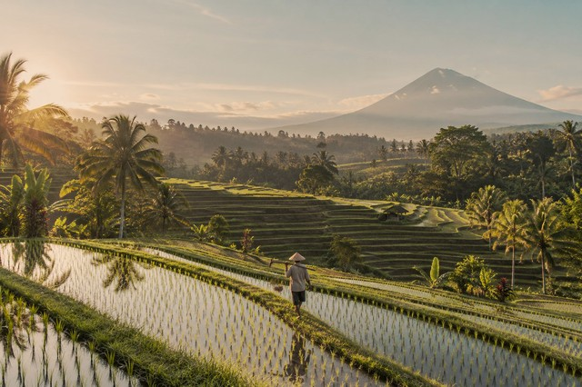

---

#### Momints Provia 100F (`momints-provia-100f`)
- **Inspiration:** *Fuji Provia 100F (E-6)*
- **Look & Mood:** Faithful, neutral slide film. Uncompromising daylight color accuracy and clean emerald greens.
- **Visual Traits:** `daylight balanced` · `neutral color` · `emerald clarity` · `true fidelity`

---

### Category: Black & White

#### Momints Silver 400 (`momints-silver-400`)
- **Inspiration:** *Kodak Tri-X 400 (B&W)*
- **Look & Mood:** Classic photojournalistic silver halide. Gritty high-contrast punch with rich velvety blacks.
- **Visual Traits:** `monochrome` · `high contrast` · `punchy blacks` · `photojournalism`

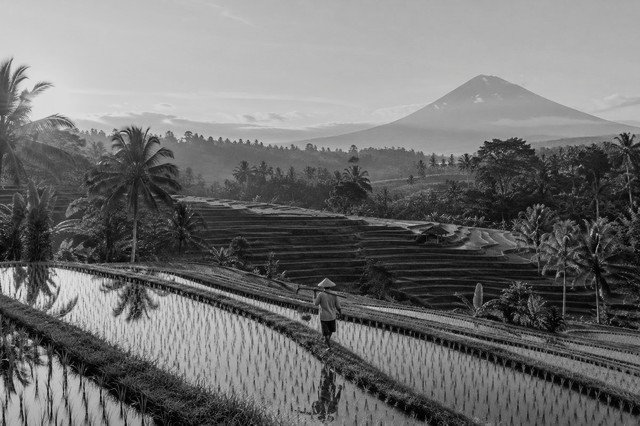

---

#### Momints HP5 Plus (`momints-hp5-plus`)
- **Inspiration:** *Ilford HP5 Plus (B&W)*
- **Look & Mood:** Smooth wide tonal latitude with gentle highlight roll-off and balanced medium contrast.
- **Visual Traits:** `smooth tonal range` · `gentle highlights` · `classic ilford` · `rich midtones`

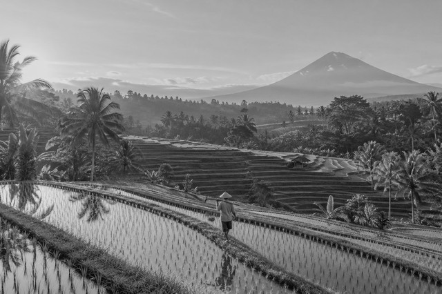

---

### Category: Cine & Specialty

#### Momints Neon 800T (`momints-neon-800t`)
- **Inspiration:** *CineStill 800T / Vision3 500T*
- **Look & Mood:** Tungsten balanced cinema emulsion. Deep teal night shadows and warm highlight glow.
- **Visual Traits:** `tungsten balance` · `teal shadows` · `night shooting` · `cinema look`

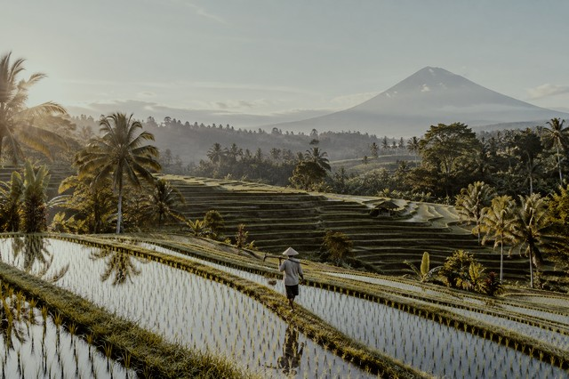

---

### Category: Creative Specialty

#### Momints Lomo Purple (`momints-lomo-purple`)
- **Inspiration:** *LomoChrome Purple XR*
- **Look & Mood:** Surreal experimental infrared shift: foliage greens transform into electric violet and magenta.
- **Visual Traits:** `color shift` · `violet foliage` · `surreal infrared` · `lomography style`

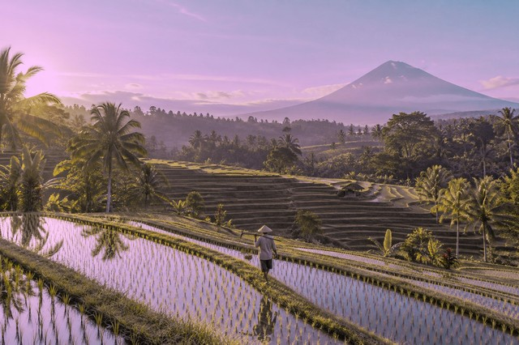

---

### Category: Vintage Reversal

#### Martha (`martha-v1`)
- **Inspiration:** *Vintage Saturation Reversal*
- **Look & Mood:** Lush saturation, rich jewel colors, lifted matte blacks, and classic nostalgic tone.
- **Visual Traits:** `lush saturation` · `rich colors` · `lifted blacks` · `vintage tone`

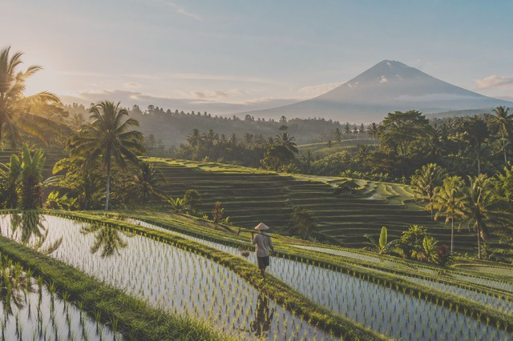

---

## 3. How Trav Can Deploy Any Stock to Staging

1. **Zero App Rebuilds:** The Momints app downloads selected film stock packages on-demand from the Cloudflare Worker via `GET /v1/filmstocks`.
2. **Staging Packages:** All 12 stocks have compiled 33-point `.cube` and runtime `.lut` assets staged in `worker/filmstock-sources/` and `worker/filmstock-assets/`.
3. **Publishing a Batch:** To activate any stock for users or testing, Trav simply updates `worker/filmstock-catalogue.json` with the chosen stock IDs and deploys the Worker.
